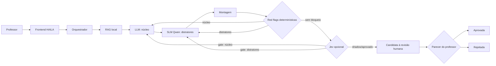

# HAILA

HAILA é uma arquitetura híbrida para gerar questões objetivas no formato ENADE com rastreabilidade e revisão humana. O código operacional está separado da interface e dos experimentos da pesquisa.

## Arquitetura



O RAG recupera uma referência do acervo local. A LLM produz enunciado, resposta correta e explicação. A SLM local produz os distratores. Regras determinísticas verificam estrutura, duplicidade, formatação, vazamentos e dependências ausentes. A aprovação pedagógica permanece humana.

## Pastas

- `backend/`: API, orquestração, RAG, geradores, regras e persistência.
- `frontend/`: HAILA Studio e proxy local restrito.
- `research/`: protocolos e componentes experimentais da dissertação.
- `docs/`: documentação da arquitetura e do contrato da API.
- `runtime/`: banco e saídas locais; não deve ser versionado.
- `archive/`: orientação sobre o código legado preservado.

## Execução

Crie e ative um ambiente Python, instale `backend/requirements.txt` e copie `.env.example` para `.env`. Depois, em dois terminais:

```bash
make backend
make frontend
```

A API ficará em `http://127.0.0.1:8000` e o HAILA Studio em `http://127.0.0.1:4173/studio.html`.

## Verificação

```bash
make test
```

## Execução no VS Code

1. Abra a pasta raiz `HAILA` no VS Code.
2. Copie `.env.example` para `.env` e preencha `GROQ_API_KEY` somente no arquivo local.
3. Abra **Executar e Depurar** e selecione **HAILA: Front + Back**.
4. Acesse `http://127.0.0.1:4174/studio.html`.

As tarefas **HAILA: Testes**, **HAILA: Ablação C1-C3**, **HAILA: Ablação C4** e **HAILA: Consolidar tokens exatos** ficam disponíveis em **Terminal > Executar Tarefa**. Os resultados são gravados em `evaluation/results/`. O consolidado separa os tokens pagos da Groq dos tokens processados localmente pela SLM.

A avaliação pedagógica final permanece humana. Jev pode ser habilitado como camada semântica experimental e opcional após as Red Flags determinísticas. Por padrão, `HAILA_JEV_ENABLED=0`; em `shadow`, seus sinais são apenas registrados. O objetivo é medir concordância, latência e custo contra pareceres docentes, não substituir professores.


## Jev experimental

A integração usa TypeSafe System One e cinco decisões `noul` em uma chamada:
unicidade do gabarito, clareza, alinhamento pedagógico, plausibilidade dos
distratores e ausência de ambiguidade.

Comece em `shadow`:

```bash
HAILA_JEV_ENABLED=1
HAILA_JEV_MODE=shadow
TYPESAFE_API_KEY=...
```

Em `shadow`, o Jev não bloqueia nem regenera. `gate` exige limiares
explicitamente configurados e calibrados contra avaliações docentes.
